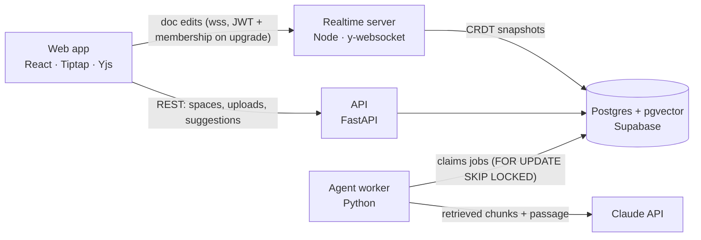

# Gloss

[](https://github.com/vinhhuynh1/gloss/actions/workflows/ci.yml)

A study group's shared notes, with an AI collaborator that has read the course
material. Gloss is a real-time collaborative editor where the AI cites the
exact source passage behind every claim, flags notes that contradict the
material, and fills gaps — always as a suggestion the group accepts or
rejects, never as an edit to the shared document.

<!-- Demo GIF: two browsers editing one doc, then Check with AI producing a cited suggestion.
 -->

**[Try the demo →](https://gloss-coral.vercel.app/#/demo)** (no account needed)

## What it does

- **Edit together, live.** Multiplayer cursors and presence over a Yjs CRDT,
  synced through an authenticated WebSocket server that persists to Postgres.
- **Upload the course.** PDFs and notes are chunked, embedded and scoped to
  one study space, so one course's material never leaks into another's answers.
- **Check with AI.** Select a passage and the agent retrieves from that space's
  sources and returns one verdict — a citation, a contradiction, or a gap to
  fill — highlighted in the doc and carded in the sidebar with the excerpt it
  rests on. A verdict that cites nothing it was shown is dropped, not shown.
- **Study guide.** The whole notes doc turned into a revision sheet where every
  point carries the source excerpt it came from, laid out for print-to-PDF.
- **Quizzes and weak spots.** Generate a quiz from the notes; missed questions
  are tracked per section, and a practice quiz targets only the weak ones.
- **Chat and comments.** Ask the space's chat about the sources or have it
  draft notes from whole files; comment threads with @-mentions on the doc.
- **Demo mode.** A visitor gets a private copy of a sample study space without
  an account, with per-guest limits, cleaned up after 24 hours.

## Architecture



| Piece | Stack | Lives in |
|---|---|---|
| Editor | React 18, Tiptap 2, Yjs, strict TypeScript | `apps/web` |
| Sync | y-websocket server, auth on upgrade, single writer of document state | `apps/realtime` |
| API | FastAPI, SQLAlchemy, Supabase JWT (JWKS), one authz module | `apps/api` |
| Ingestion + agent | sentence-transformers embeddings, pgvector retrieval, schema-constrained Claude calls | `apps/agent-worker` |
| Eval | 36 labelled cases on two courses, five metrics, reproducible run records | `eval/` |
| Schema | 17 portable Postgres migrations + Supabase RLS lockdown | `infra/` |

The agent is a separate worker, not part of the editing path: the API and
editor queue requests in Postgres, the worker claims them, and suggestions are
written back as rows the editor renders as decorations. That separation is what
lets the agent be evaluated, rate-limited and scaled without touching sync.

## Measured, not eyeballed

The agent is scored against hand-written cases — passages that correctly
restate the source, planted factual errors, and notes with an obvious gap —
on two courses: a biology handout written for this repo, and an economics set
built from verbatim Wikipedia text nobody wrote to be graded. Every run records
the model, prompt hash, `top_k`, chunk size and a fingerprint of the corpus
behind its numbers.

| | baseline (Sept) | best logged (Sept) | biology today (2 runs) | economics today |
|---|---|---|---|---|
| type accuracy | 67% | 72% | 50–56% | 67% |
| flag precision | 71% | 80% | 75% | 75% |
| flag recall | 100% | 100% | 100% | 100% |
| grounding accuracy | 83% | 92% | 92% | 92% |
| retrieval recall@k | 92% | 92% | 92% | 92% |

Contradiction detection, grounding and retrieval hold steady across both
courses and every run. The weak spot is the choice between adding a citation,
suggesting a gap fill, and staying quiet: the agent over-suggests gap fills on
both courses, and the choice is unstable enough that two runs of the same code
miss different cases. The best logged 72% does not reproduce on today's code,
and one run of 18 cases cannot measure that boundary — so the next change to it
gets several runs per side.

The [eval log](eval/CHANGELOG.md) is more useful than the table: one change at
a time, with the run behind every number. One queued change was dropped
without being run because the baseline showed its failure mode never occurred.
One change made the score *worse* and was kept, because it exposed a prompt bug
that the next change fixed. Retrieval recall@k never moved across any run on
either course — every point came from the prompt, which is worth knowing before
spending anything on the retriever.

## Problems worth talking about

- **Suggestions that survive concurrent edits.** A suggestion is anchored with
  two Yjs relative positions (`apps/web/src/lib/anchors.ts`), so it keeps
  pointing at the same characters however the doc is edited around it.
  Accepting records the decision first — the API refuses a second one — so two
  people accepting at once cannot insert the text twice.
- **Exactly one realtime replica.** Two replicas would each hold their own copy
  of an open document and the last to flush would silently win. The constraint
  is pinned in `railway.json` and explained at the top of
  `apps/realtime/server.js`.
- **Designing to the free tier's real limit.** Supabase's binding constraint is
  egress, not storage, and the app reads on poll loops. Unbounded columns are
  deferred on the mapper (`apps/api/models.py`), because leaving a field out of
  the response keeps it off the wire but not out of the query.
- **Authorization that doesn't leak existence.** Every route resolves access
  through `apps/api/authz.py`; a personal quiz returns 404, not 403, to anyone
  else, so a groupmate cannot learn it exists. Guest quotas take a per-guest
  Postgres lock so parallel requests cannot overspend them.
- **A worker that tolerates crashes and deploys.** Jobs are claimed with
  `FOR UPDATE SKIP LOCKED` and stale claims are reclaimed, so replicas are safe
  and a worker killed mid-deploy loses nothing.

## Status and limits

Everything above is built and runs end to end. Open:

- The eval covers two subjects, and neither is a real course's slides: a
  synthetic biology handout and Wikipedia text on supply and demand
  (`eval/test_cases/`).
- Gap-fill suggestions over-fire and vary from run to run (see above).
- The agent runs on demand; a debounced background pass is not built yet.
- Contradiction detection works within one source, not across two.
- Uploaded files live as `bytea` in Postgres (20 MB each); object storage is
  the upgrade path past the free tier's 500 MB.

## Run it

- [Local setup](docs/setup.md) — Postgres in Docker, the four services, the
  eval, and the one-shot debugging scripts.
- [Deploy](docs/deploy.md) — Supabase, Railway and Vercel, the environment
  variables that actually bite, demo-mode setup, and how to verify a deploy.
- [`infra/README.md`](infra/README.md) — migration order and Supabase specifics.

## Repository layout

```
apps/
  web/              React + Tiptap + Yjs collaborative editor
  api/              FastAPI backend: study spaces, documents, suggestions
  realtime/         Yjs WebSocket sync server (auth on upgrade, Postgres persistence)
  agent-worker/     Ingestion worker + retrieval + the AI agent process
packages/
  shared/           Shared TypeScript types
eval/
  test_cases/       Hand-written cases: source + notes + expected agent behavior
  run_eval.py       Scores the agent against test_cases
  judge.py          Optional: asks the model whether a citation really supports
  results/          One JSON record per run, with the config that produced it
  CHANGELOG.md      What each change did to the score
infra/
  migrations/       Portable Postgres schema (pgvector extension)
  supabase/         Supabase-only: auth mirroring and RLS lockdown
docs/
  setup.md          Local setup, eval, debugging scripts
  deploy.md         Supabase + Railway + Vercel, env vars, demo mode
```
